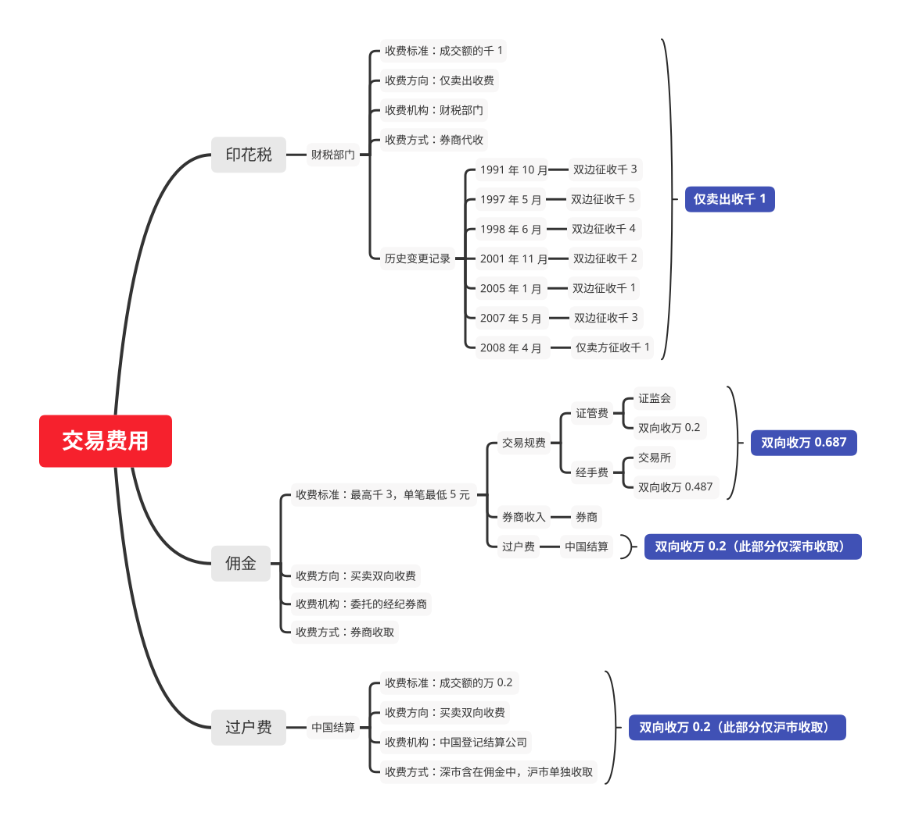

# 股票数据-其他

## 手续费

### 国内券商佣金

#### 以万 2.5 佣金结构为例

深圳证券交易所

| 项目   | 费用      | 收取部门    |
|------|---------|---------|
| 过户费  | 万 0.2   | 由中国结算收取 |
| 证管费  | 万 0.2   | 由证监会收取  |
| 经手费  | 万 0.487 | 由交易所收取  |
| 券商收入 | 万 1.613 | 由券商收取   |

上海证券交易所

| 项目   | 费用      | 收取部门   |
|------|---------|--------|
| 证管费  | 万 0.2   | 由证监会收取 |
| 经手费  | 万 0.487 | 由交易所收取 |
| 券商收入 | 万 1.813 | 由券商收取  |

#### 以万 1.2 佣金结构为例

深圳证券交易所

| 项目   | 费用      | 收取部门    |
|------|---------|---------|
| 过户费  | 万 0.2   | 由中国结算收取 |
| 证管费  | 万 0.2   | 由证监会收取  |
| 经手费  | 万 0.487 | 由交易所收取  |
| 券商收入 | 万 0.313 | 由券商收取   |

上海证券交易所

| 项目   | 费用      | 收取部门   |
|------|---------|--------|
| 证管费  | 万 0.2   | 由证监会收取 |
| 经手费  | 万 0.487 | 由交易所收取 |
| 券商收入 | 万 0.513 | 由券商收取  |

#### 结构图



## 技术指标

(stock_rank_cxg_ths)=
### 创新高

接口：stock_rank_cxg_ths

目标地址：https://data.10jqka.com.cn/rank/cxg/

描述：同花顺-数据中心-技术选股-创新高

限量：单次指定 symbol 的所有数据

输入参数

| 名称     | 类型  | 描述                                                        |
|--------|-----|-----------------------------------------------------------|
| symbol | str | symbol="创月新高"; choice of {"创月新高", "半年新高", "一年新高", "历史新高"} |

输出参数

| 名称     | 类型      | 描述      |
|--------|---------|---------|
| 序号     | int64   | -       |
| 股票代码   | str     | -       |
| 股票简称   | str     | -       |
| 涨跌幅    | float64 | 注意单位：% |
| 换手率    | float64 | 注意单位：% |
| 最新价    | float64 | 注意单位：元 |
| 前期高点   | float64 | -       |
| 前期高点日期 | object  | -       |

接口示例：

```python
import akshare as ak

stock_rank_cxg_ths_df = ak.stock_rank_cxg_ths(symbol="创月新高")
print(stock_rank_cxg_ths_df)
```

数据示例

```
    序号 股票代码  股票简称  涨跌幅 换手率  最新价  前期高点  前期高点日期
0    1  000157  中联重科   1.23  1.20   7.44   7.37  2024-01-30
1    2  000333  美的集团   2.06  0.67  59.45  58.81  2024-02-01
2    3  000423  东阿阿胶   3.25  1.86  55.25  55.09  2024-01-29
3    4  000425  徐工机械   2.71  1.57   5.69   5.68  2024-01-29
4    5  000429  粤高速A   4.28  1.54   9.75   9.35  2024-02-02
..  ..     ...   ...    ...   ...    ...    ...         ...
63  64  603156  养元饮品   5.03  0.70  24.62  23.44  2024-02-02
64  65  603195  公牛集团   2.95  0.25  96.96  95.03  2024-01-29
65  66  603369   今世缘   1.00  0.80  47.55  47.08  2024-02-02
66  67  603871  嘉友国际   4.32  1.48  19.81  19.64  2024-01-31
67  68  603960  克来机电  10.01  2.62  15.82  14.38  2024-02-02
[68 rows x 8 columns]
```

(stock_rank_cxd_ths)=
### 创新低

接口：stock_rank_cxd_ths

目标地址：https://data.10jqka.com.cn/rank/cxd/

描述：同花顺-数据中心-技术选股-创新低

限量：单次指定 symbol 的所有数据

输入参数

| 名称     | 类型  | 描述                                                        |
|--------|-----|-----------------------------------------------------------|
| symbol | str | symbol="创月新低"; choice of {"创月新低", "半年新低", "一年新低", "历史新低"} |

输出参数

| 名称     | 类型      | 描述      |
|--------|---------|---------|
| 序号     | int64   | -       |
| 股票代码   | str     | -       |
| 股票简称   | str     | -       |
| 涨跌幅    | float64 | 注意单位：% |
| 换手率    | float64 | 注意单位：% |
| 最新价    | float64 | 注意单位：元 |
| 前期低点   | float64 | -       |
| 前期低点日期 | object  | -       |

接口示例：

```python
import akshare as ak

stock_rank_cxd_ths_df = ak.stock_rank_cxd_ths(symbol="创月新低")
print(stock_rank_cxd_ths_df)
```

数据示例

```
     序号   股票代码  股票简称  涨跌幅 换手率  最新价  前期低点  前期低点日期
0        1  000004  国华网安 -10.04  3.97  10.22  11.36  2024-02-02
1        2  000005  ST星源  -4.71  0.22   0.81   0.85  2024-02-02
2        3  000006  深振业A  -9.62  3.56   3.57   3.93  2024-02-01
3        4  000008  神州高铁  -5.37  1.17   1.94   2.05  2024-02-02
4        5  000009  中国宝安  -4.21  1.20  10.00  10.44  2024-02-02
    ...     ...   ...    ...   ...    ...    ...         ...
3535  3536  605580  恒盛能源 -10.01  4.73   8.09   8.99  2024-02-02
3536  3537  605588  冠石科技 -10.00  7.30  32.77  36.41  2024-02-02
3537  3538  605589  圣泉集团  -4.05  2.18  16.10  16.78  2024-02-02
3538  3539  605598  上海港湾  -9.97  4.55  15.35  17.05  2024-02-02
3539  3540  605599  菜百股份  -2.93  0.74  11.27  11.61  2024-02-02
[3540 rows x 8 columns]
```

(stock_rank_lxsz_ths)=
### 连续上涨

接口：stock_rank_lxsz_ths

目标地址：https://data.10jqka.com.cn/rank/lxsz/

描述：同花顺-数据中心-技术选股-连续上涨

限量：单次返回所有数据

输入参数

| 名称  | 类型  | 描述  |
|-----|-----|-----|
| -   | -   | -   |

输出参数

| 名称    | 类型      | 描述      |
|-------|---------|---------|
| 序号    | int64   | -       |
| 股票代码  | str     | -       |
| 股票简称  | str     | -       |
| 收盘价   | float64 | 注意单位：元 |
| 最高价   | float64 | 注意单位：元 |
| 最低价   | float64 | 注意单位：元 |
| 连涨天数  | int64   | -       |
| 连续涨跌幅 | float64 | 注意单位：% |
| 累计换手率 | float64 | 注意单位：% |
| 所属行业  | str     | -       |

接口示例

```python
import akshare as ak

stock_rank_lxsz_ths_df = ak.stock_rank_lxsz_ths()
print(stock_rank_lxsz_ths_df)
```

数据示例

```
    序号股票代码  股票简称  收盘价  最高价  最低价  连涨天数  连续涨跌幅 累计换手率 所属行业
0    1  603192  汇得科技   27.33   27.87   24.31     7   2.90  10.05   化学制品
1    2  688330   宏力达   98.50   99.30   83.24     7   6.41  21.48   电力设备
2    3  300870   欧陆通   67.60   67.99   58.08     5   6.46   7.75   电力设备
3    4  603507  振江股份   47.70   48.21   35.28     5  21.59  36.38   电力设备
4    5  603855  华荣股份   23.50   24.12   20.91     5   8.60   6.72   专用设备
..  ..     ...   ...     ...     ...     ...   ...    ...    ...    ...
58  59  688122  西部超导   81.26   82.50   75.37     3   5.12   5.13   国防军工
59  60  688166  博瑞医药   33.39   34.16   30.31     3   0.57   4.75   化学制药
60  61  688369  致远互联   59.30   60.97   55.22     3   6.23   1.74  计算机应用
61  62  688395  正弦电气   25.45   25.93   23.85     3   6.71  10.89  自动化设备
62  63  688788  科思科技  139.13  140.20  126.53     3   7.84   7.82   国防军工
```

(stock_rank_lxxd_ths)=
### 连续下跌

接口：stock_rank_lxxd_ths

目标地址：https://data.10jqka.com.cn/rank/lxxd/

描述：同花顺-数据中心-技术选股-连续下跌

限量：单次返回所有数据

输入参数

| 名称  | 类型  | 描述  |
|-----|-----|-----|
| -   | -   | -   |

输出参数

| 名称    | 类型      | 描述      |
|-------|---------|---------|
| 序号    | int64   | -       |
| 股票代码  | str     | -       |
| 股票简称  | str     | -       |
| 收盘价   | float64 | 注意单位：元 |
| 最高价   | float64 | 注意单位：元 |
| 最低价   | float64 | 注意单位：元 |
| 连涨天数  | int64   | -       |
| 连续涨跌幅 | float64 | 注意单位：% |
| 累计换手率 | float64 | 注意单位：% |
| 所属行业  | str     | -       |

接口示例：

```python
import akshare as ak

stock_rank_lxxd_ths_df = ak.stock_rank_lxxd_ths()
print(stock_rank_lxxd_ths_df)
```

数据示例

```
     序号   股票代码  股票简称  收盘价 最高价  最低价  连涨天数 连续涨跌幅 累计换手率 所属行业
0        1  603038  华立股份   8.02  19.60   7.75    14 -55.30  178.79    建筑材料
1        2  605180  华生科技   7.38  16.87   7.38    14 -56.64  265.53    纺织制造
2        3  605255  天普股份   9.82  22.00   9.82    12 -52.24   73.00   汽车零部件
3        4  000889  ST中嘉   1.46   2.28   1.46    11 -35.40   27.92    通信服务
4        5  001217   华尔泰   8.34  17.03   8.06    11 -50.00  234.23    化学原料
    ...     ...   ...    ...    ...    ...   ...    ...     ...     ...
1315  1316  603922   金鸿顺  21.70  23.00  20.70     3  -9.43    2.94   汽车零部件
1316  1317  605218  伟时电子  13.55  19.74  13.55     3 -27.03   21.34   光学光电子
1317  1318  605296  神农集团  27.26  28.54  26.60     3  -4.35   14.78     养殖业
1318  1319  688087  英科再生  19.05  20.50  18.21     3  -7.07    3.97  化工合成材料
1319  1320  688398  赛特新材  25.79  30.80  24.37     3 -17.97    4.15    化学制品
[1320 rows x 10 columns]
```

(stock_rank_cxfl_ths)=
### 持续放量

接口：stock_rank_cxfl_ths

目标地址：https://data.10jqka.com.cn/rank/cxfl/

描述：同花顺-数据中心-技术选股-持续放量

限量：单次返回所有数据

输入参数

| 名称  | 类型  | 描述  |
|-----|-----|-----|
| -   | -   | -   |

输出参数

| 名称     | 类型      | 描述      |
|--------|---------|---------|
| 序号     | int64   | -       |
| 股票代码   | str     | -       |
| 股票简称   | str     | -       |
| 涨跌幅    | float64 | 注意单位：% |
| 最新价    | float64 | 注意单位：元 |
| 成交量    | str     | 注意单位：股 |
| 基准日成交量 | str     | 注意单位：股 |
| 放量天数   | int64   | -       |
| 阶段涨跌幅  | float64 | 注意单位：% |
| 所属行业   | str     | -       |

接口示例

```python
import akshare as ak

stock_rank_cxfl_ths_df = ak.stock_rank_cxfl_ths()
print(stock_rank_cxfl_ths_df)
```

数据示例

```
     序号    股票代码  股票简称    涨跌幅  ...      基准日成交量 放量天数  阶段涨跌幅   所属行业
0        1  000565  渝三峡A   9.97  ...   486.72万(01月26日)    8 -31.55   化学制品
1        2  000880  潍柴重机  -5.37  ...   354.53万(01月26日)    8 -29.51  汽车零部件
2        3  000959  首钢股份   2.82  ...  2486.70万(01月26日)    8  -1.80     钢铁
3        4  002159  三特索道  -6.66  ...   418.88万(01月26日)    8 -30.14  景点及旅游
4        5  002286   保龄宝  -9.55  ...   298.40万(01月26日)    8 -36.36  农产品加工
    ...     ...   ...    ...  ...               ...  ...    ...    ...
1139  1140  688656   浩欧博  -7.63  ...    67.71万(02月02日)    3 -16.46   医疗器械
1140  1141  688658  悦康药业   2.36  ...   364.38万(02月02日)    3  -1.42   化学制药
1141  1142  688677  海泰新光   4.57  ...   116.19万(02月02日)    3  13.83   医疗器械
1142  1143  688683  莱尔科技 -16.04  ...   133.01万(02月02日)    3 -31.20   消费电子
1143  1144  688701  卓锦股份 -14.72  ...   219.35万(02月02日)    3 -34.92     环保
[1144 rows x 10 columns]
```

(stock_rank_cxsl_ths)=
### 持续缩量

接口：stock_rank_cxsl_ths

目标地址：https://data.10jqka.com.cn/rank/cxsl/

描述：同花顺-数据中心-技术选股-持续缩量

限量：单次返回所有数据

输入参数

| 名称  | 类型  | 描述  |
|-----|-----|-----|
| -   | -   | -   |

输出参数

| 名称     | 类型      | 描述      |
|--------|---------|---------|
| 序号     | int64   | -       |
| 股票代码   | str     | -       |
| 股票简称   | str     | -       |
| 涨跌幅    | float64 | 注意单位：% |
| 最新价    | float64 | 注意单位：元 |
| 成交量    | str     | 注意单位：股 |
| 基准日成交量 | str     | 注意单位：股 |
| 缩量天数   | int64   | -       |
| 阶段涨跌幅  | float64 | 注意单位：% |
| 所属行业   | str     | -       |

接口示例

```python
import akshare as ak

stock_rank_cxsl_ths_df = ak.stock_rank_cxsl_ths()
print(stock_rank_cxsl_ths_df)
```

数据示例

```
    序号  股票代码  股票简称 涨跌幅  ...     基准日成交量 缩量天数  阶段涨跌幅    所属行业
0      1  300350   华鹏飞 -4.59  ...     1.14亿(01月24日)   10 -37.46   计算机应用
1      2  688648  中邮科技 -5.08  ...  1622.39万(01月29日)    7 -28.90    通用设备
2      3  000058   深赛格  1.89  ...  5392.48万(01月30日)    6 -22.18      零售
3      4  600121  郑州煤电 -2.80  ...  5509.10万(01月30日)    6 -22.19  煤炭开采加工
4      5  600816  建元信托 -1.93  ...     1.94亿(01月30日)    6  -9.29   保险及其他
..   ...     ...   ...   ...  ...               ...  ...    ...     ...
112  113  688093  世华科技 -0.98  ...   483.17万(02月02日)    3  -5.13    其他电子
113  114  688293   奥浦迈  0.80  ...   170.12万(02月02日)    3   5.61    医疗服务
114  115  688334   西高院 -1.69  ...   278.80万(02月02日)    3  -1.20  其他社会服务
115  116  688376  美埃科技 -1.18  ...   158.60万(02月02日)    3   5.94      环保
116  117  688787  海天瑞声 -4.58  ...   302.30万(02月02日)    3 -17.38   计算机应用
[117 rows x 10 columns]
```

(stock_rank_xstp_ths)=
### 向上突破

接口：stock_rank_xstp_ths

目标地址：https://data.10jqka.com.cn/rank/xstp/

描述：同花顺-数据中心-技术选股-向上突破

限量：单次返回所有数据

输入参数

| 名称     | 类型  | 描述                                                                                                   |
|--------|-----|------------------------------------------------------------------------------------------------------|
| symbol | str | symbol="500日均线"; choice of {"5日均线", "10日均线", "20日均线", "30日均线", "60日均线", "90日均线", "250日均线", "500日均线"} |

输出参数

| 名称   | 类型      | 描述      |
|------|---------|---------|
| 序号   | int64   | -       |
| 股票代码 | str     | -       |
| 股票简称 | str     | -       |
| 最新价  | float64 | 注意单位：元 |
| 成交额  | str     | 注意单位：元 |
| 成交量  | str     | 注意单位：股 |
| 涨跌幅  | float64 | 注意单位：% |
| 换手率  | float64 | 注意单位：% |

接口示例

```python
import akshare as ak

stock_rank_xstp_ths_df = ak.stock_rank_xstp_ths(symbol="500日均线")
print(stock_rank_xstp_ths_df)
```

数据示例

```
   序号    股票代码  股票简称  最新价  成交额  成交量    涨跌幅    换手率
0      1  300466  赛摩智能   6.13  6.42亿  9499.20万 -11.03  22.62
1      2  300374  中铁装配  14.28  6.98亿  4488.57万 -10.69  23.72
2      3  000972  中基健康   4.58  4.62亿  8499.21万 -10.02  11.02
3      4  600630  龙头股份   9.70  8.09亿  7629.75万 -10.02  17.96
4      5  603721  中广天择  17.24  3.40亿  1934.10万 -10.02  14.88
..   ...     ...   ...    ...    ...       ...    ...    ...
385  386  603178  圣龙股份  27.89  2.87亿  1066.88万  10.02   4.51
386  387  603225   新凤鸣  13.37  2.67亿  2070.78万  10.04   1.35
387  388  688728   格科微  19.96  3.61亿  1882.35万  11.63   1.69
388  389  688127  蓝特光学  19.74  1.54亿   818.44万  12.74   3.40
389  390  300128  锦富技术   4.20  3.43亿  8830.80万  16.02   8.07
[390 rows x 8 columns]
```

(stock_rank_xxtp_ths)=
### 向下突破

接口：stock_rank_xxtp_ths

目标地址：https://data.10jqka.com.cn/rank/xxtp/

描述：同花顺-数据中心-技术选股-向下突破

限量：单次返回所有数据

输入参数

| 名称     | 类型  | 描述                                                                                                   |
|--------|-----|------------------------------------------------------------------------------------------------------|
| symbol | str | symbol="500日均线"; choice of {"5日均线", "10日均线", "20日均线", "30日均线", "60日均线", "90日均线", "250日均线", "500日均线"} |

输出参数

| 名称   | 类型      | 描述      |
|------|---------|---------|
| 序号   | int64   | -       |
| 股票代码 | str     | -       |
| 股票简称 | str     | -       |
| 最新价  | float64 | 注意单位：元 |
| 成交额  | str     | 注意单位：元 |
| 成交量  | str     | 注意单位：股 |
| 涨跌幅  | float64 | 注意单位：% |
| 换手率  | float64 | 注意单位：% |

接口示例

```python
import akshare as ak

stock_rank_xxtp_ths_df = ak.stock_rank_xxtp_ths(symbol="500日均线")
print(stock_rank_xxtp_ths_df)
```

数据示例

```
     序号    股票代码   股票简称  最新价   成交额     成交量    涨跌幅   换手率
0        1  301106   骏成科技  28.00  7312.44万   234.10万 -20.00  11.23
1        2  300405   科隆股份   3.61     1.25亿  3107.45万 -19.96  14.20
2        3  300391   长药控股   3.16  8421.59万  2479.90万 -19.80   7.08
3        4  300716   泉为科技   5.01  6863.18万  1282.18万 -18.40   8.01
4        5  300710   万隆光电  11.06  6636.05万   559.99万 -17.95   6.30
    ...     ...    ...    ...       ...       ...    ...    ...
3267  3268  000565   渝三峡A   3.97     1.00亿  2680.46万   9.97   6.18
3268  3269  605155    西大门  10.91     1.04亿  1054.60万   9.98   7.85
3269  3270  002453   华软科技   6.05  9283.25万  1578.67万  10.00   2.60
3270  3271  002819   东方中科  22.40     1.41亿   649.21万  10.02   2.77
3271  3272  300799  *ST左江  20.86     2.54亿  1554.33万  20.02  23.00
[3272 rows x 8 columns]
```

(stock_rank_ljqs_ths)=
### 量价齐升

接口：stock_rank_ljqs_ths

目标地址：https://data.10jqka.com.cn/rank/ljqs/

描述：同花顺-数据中心-技术选股-量价齐升

限量：单次返回所有数据

输入参数

| 名称  | 类型  | 描述  |
|-----|-----|-----|
| -   | -   | -   |

输出参数

| 名称     | 类型      | 描述      |
|--------|---------|---------|
| 序号     | int64   | -       |
| 股票代码   | str     | -       |
| 股票简称   | str     | -       |
| 最新价    | float64 | 注意单位：元 |
| 量价齐升天数 | int64   | -       |
| 阶段涨幅   | float64 | 注意单位：% |
| 累计换手率  | float64 | 注意单位：% |
| 所属行业   | str     | -       |

接口示例

```python
import akshare as ak

stock_rank_ljqs_ths_df = ak.stock_rank_ljqs_ths()
print(stock_rank_ljqs_ths_df)
```

数据示例

```
    序号    股票代码  股票简称  最新价  量价齐升天数   阶段涨幅  累计换手率    所属行业
0        1  000423  东阿阿胶  60.12       4  14.51   6.77      中药
1        2  000932  华菱钢铁   5.71       4   5.94   5.57      钢铁
2        3  002028  思源电气  57.99       4  14.02   7.04    电力设备
3        4  002444  巨星科技  22.04       4  18.88   6.16    通用设备
4        5  002595  豪迈科技  32.80       4  21.48   4.45    专用设备
    ...     ...   ...    ...     ...    ...    ...     ...
1588  1589  688711  宏微科技  26.54       1   6.29   5.47  半导体及元件
1589  1590  688739  成大生物  28.90       1   2.88   1.99    生物制品
1590  1591  688798  艾为电子  54.03       1   3.31   2.17  半导体及元件
1591  1592  688799  华纳药厂  36.95       1   4.23   4.11    化学制药
1592  1593  689009  九号公司  28.04       1   7.68   1.76   非汽车交运
[1593 rows x 8 columns]
```

(stock_rank_ljqd_ths)=
### 量价齐跌

接口：stock_rank_ljqd_ths

目标地址：https://data.10jqka.com.cn/rank/ljqd/

描述：同花顺-数据中心-技术选股-量价齐跌

限量：单次返回所有数据

输入参数

| 名称  | 类型  | 描述  |
|-----|-----|-----|
| -   | -   | -   |

输出参数

| 名称     | 类型      | 描述      |
|--------|---------|---------|
| 序号     | int64   | -       |
| 股票代码   | str     | -       |
| 股票简称   | str     | -       |
| 最新价    | float64 | 注意单位：元 |
| 量价齐跌天数 | int64   | -       |
| 阶段涨幅   | float64 | 注意单位：% |
| 累计换手率  | float64 | 注意单位：% |
| 所属行业   | str     | -       |

接口示例

```python
import akshare as ak

stock_rank_ljqd_ths_df = ak.stock_rank_ljqd_ths()
print(stock_rank_ljqd_ths_df)
```

数据示例

```
    序号    股票代码  股票简称  最新价  量价齐跌天数  阶段涨幅 累计换手率  所属行业
0        1  600322  津投城开   1.53       5 -22.73   21.21   房地产开发
1        2  600622  光大嘉宝   2.21       5 -28.94   45.42   房地产开发
2        3  603082  北自科技  25.84       5 -45.83  248.34    通用设备
3        4  002269  美邦服饰   1.53       4 -17.30   20.10    服装家纺
4        5  002523  天桥起重   2.52       4 -22.94   24.58    专用设备
    ...     ...   ...    ...     ...    ...     ...     ...
1464  1465  688719  爱科赛博  44.18       1  -3.85    4.42    电力设备
1465  1466  688722   同益中  10.76       1  -0.46    1.45  化工合成材料
1466  1467  688737  中自科技  19.15       1  -5.53    1.59   汽车零部件
1467  1468  688767  博拓生物  23.20       1  -2.93    1.80    医疗器械
1468  1469  688787  海天瑞声  40.17       1  -4.58    5.64   计算机应用
[1469 rows x 8 columns]
```

(stock_rank_xzjp_ths)=
### 险资举牌

接口：stock_rank_xzjp_ths

目标地址：https://data.10jqka.com.cn/financial/xzjp/

描述：同花顺-数据中心-技术选股-险资举牌

限量：单次返回所有数据

输入参数

| 名称  | 类型  | 描述  |
|-----|-----|-----|
| -   | -   | -   |

输出参数

| 名称         | 类型      | 描述      |
|------------|---------|---------|
| 序号         | int64   | -       |
| 举牌公告日      | object  | -       |
| 股票代码       | str     | -       |
| 股票简称       | str     | -       |
| 现价         | float64 | 注意单位：元 |
| 涨跌幅        | float64 | 注意单位：% |
| 举牌方        | str     | -       |
| 增持数量       | str     | 注意单位：股 |
| 交易均价       | float64 | 注意单位：元 |
| 增持数量占总股本比例 | float64 | 注意单位：% |
| 变动后持股总数    | str     | 注意单位：股 |
| 变动后持股比例    | float64 | 注意单位：% |

接口示例

```python
import akshare as ak

stock_rank_xzjp_ths_df = ak.stock_rank_xzjp_ths()
print(stock_rank_xzjp_ths_df)
```

数据示例

```
    序号       举牌公告日    股票代码   股票简称  ...   交易均价  增持数量占总股本比例   变动后持股总数 变动后持股比例
0    1  2025-01-04  600582   天地科技  ...   6.23        0.10     2.07亿    5.00
1    2  2024-12-24  600236   桂冠电力  ...   6.60        1.00    10.25亿   13.00
2    3  2024-12-24  002005   ST德豪  ...   1.58        0.67     1.23亿    7.04
3    4  2024-12-17  600016   民生银行  ...   2.92        0.04    21.89亿    5.00
4    5  2024-12-10  300036   超图软件  ...  19.39        4.80  2538.69万    5.15
5    6  2024-12-07  601330   绿色动力  ...   6.38        0.03     1.14亿    8.16
6    7  2024-11-27  600527   江南高纤  ...   1.97        0.02     1.10亿    6.35
7    8  2024-11-21  600113   浙江东日  ...  10.16        2.53  2129.42万    5.05
8    9  2024-11-19  001288   运机集团  ...  28.14        0.99   987.89万    5.93
9   10  2024-11-15  300436    广生堂  ...  24.50        5.02   800.00万    5.02
10  11  2024-11-15  000088    盐田港  ...   0.00        6.66     2.85亿    5.49
11  12  2024-11-15  000088    盐田港  ...   0.00        6.66     2.85亿    5.49
12  13  2024-11-15  000088    盐田港  ...   0.00        6.66     2.85亿    5.49
13  14  2024-11-15  000088    盐田港  ...   0.00        6.66     2.85亿    5.49
14  15  2024-11-15  000088    盐田港  ...   0.00        6.66     2.85亿    5.49
15  16  2024-11-15  000088    盐田港  ...   0.00        6.66     2.85亿    5.49
16  17  2024-11-15  000088    盐田港  ...   0.00        6.66     2.85亿    5.49
17  18  2024-11-14  601607   上海医药  ...  21.23        0.31     1.87亿    5.04
18  19  2024-11-14  600511   国药股份  ...  35.22        0.20  3824.44万    5.07
19  20  2024-11-13  300201    海伦哲  ...   5.07        0.85  4974.50万    5.00
20  21  2024-11-12  300499   高澜股份  ...   0.00        0.00  1729.40万    5.67
21  22  2024-11-11  300499   高澜股份  ...  13.77        5.67  1729.40万    5.67
22  23  2024-11-09  688118   普元信息  ...  22.11        5.01   471.13万    5.01
23  24  2024-11-08  002488   金固股份  ...   0.00        0.15  4978.08万    5.00
24  25  2024-10-31  601963   重庆银行  ...   7.51        0.10     1.75亿    5.03
25  26  2024-10-31  601963   重庆银行  ...   7.51        0.00     1.75亿    5.03
26  27  2024-10-17  000007    全新好  ...   5.38        5.00  1732.25万    5.00
27  28  2024-09-26  002870   香山股份  ...  28.73        0.85  2493.19万   18.88
28  29  2024-09-14  002870   香山股份  ...  28.98        0.38  2380.74万   18.03
29  30  2024-09-11  002052  *ST同洲  ...   2.38        0.45  5735.96万    7.69
30  31  2024-09-07  002870   香山股份  ...  28.87        0.63  2330.34万   17.64
31  32  2024-09-06  002005   ST德豪  ...   1.27        1.16     1.12亿    6.36
32  33  2024-09-03  002052  *ST同洲  ...   2.26        0.32  5396.98万    7.24
33  34  2024-08-30  601199   江南水务  ...   5.31        1.00  5611.41万    6.00
34  35  2024-08-28  002870   香山股份  ...  27.93        0.52  2246.98万   17.01
35  36  2024-08-24  002870   香山股份  ...  28.95        1.05  2178.52万   16.49
36  37  2024-08-23  002052  *ST同洲  ...   1.54        0.13  5155.56万    6.91
37  38  2024-08-10  603018   华设集团  ...   8.42        0.37  3612.86万    5.28
38  39  2024-08-10  603018   华设集团  ...   8.42        0.37  3612.86万    5.28
39  40  2024-08-08  002870   香山股份  ...  28.58        1.01  2039.34万   15.44
40  41  2024-08-03  002005   ST德豪  ...   1.00        5.21  9127.13万    5.21
41  42  2024-08-02  601330   绿色动力  ...   2.64        5.03  7015.00万    5.03
42  43  2024-07-27  001288   运机集团  ...  26.59        5.14   822.59万    5.14
43  44  2024-07-26  601963   重庆银行  ...   5.03        0.00     1.77亿    5.10
44  45  2024-07-26  601963   重庆银行  ...   7.97        0.00     2.95亿    8.50
[45 rows x 12 columns]
```

## ESG 评级

(stock_esg_rate_sina)=
### ESG 评级数据

接口：stock_esg_rate_sina

目标地址：https://finance.sina.com.cn/esg/grade.shtml

描述：新浪财经-ESG评级中心-ESG评级-ESG评级数据

限量：单次返回所有数据

输入参数

| 名称  | 类型  | 描述  |
|-----|-----|-----|
| -   | -   | -   |

输出参数

| 名称    | 类型     | 描述 |
|-------|--------|----|
| 成分股代码 | str    | -  |
| 评级机构  | str    | -  |
| 评级    | str    | -  |
| 评级季度  | str    | -  |
| 标识    | str    | -  |
| 交易市场  | str    | -  |

接口示例

```python
import akshare as ak

stock_esg_rate_sina_df = ak.stock_esg_rate_sina()
print(stock_esg_rate_sina_df)
```

数据示例

```
    成分股代码              评级机构     评级    评级季度             标识 交易市场
0      SZ000001             中财绿金院     A-  2022Q4            NaN   cn
1      SZ000001              商道融绿     B+  2022Q4            NaN   cn
2      SZ000001                盟浪      A  2022Q2            NaN   cn
3      SZ000001               中诚信    AA-  2023Q3            NaN   cn
4      SZ000001  晨星Sustainalytics  24.96  2022Q4  Comprehensive   cn
         ...               ...    ...     ...            ...  ...
46888   HK02361                盟浪      -  2022Q2            NaN   hk
46889   HK02361               中诚信     BB  2023Q3            NaN   hk
46890   HK02361  晨星Sustainalytics      -  2022Q4                  hk
46891   HK02361                妙盈      -  2022Q2            NaN   hk
46892   HK02361             华测CTI      -  2022Q1            NaN   hk
[46893 rows x 6 columns]
```

(stock_esg_msci_sina)=
### MSCI

接口：stock_esg_msci_sina

目标地址：https://finance.sina.com.cn/esg/grade.shtml

描述：新浪财经-ESG评级中心-ESG评级-MSCI

限量：单次返回所有数据

输入参数

| 名称  | 类型  | 描述  |
|-----|-----|-----|
| -   | -   | -   |

输出参数

| 名称     | 类型      | 描述 |
|--------|---------|----|
| 股票代码   | str     | -  |
| ESG评分  | str     | -  |
| 环境总评   | float64 | -  |
| 社会责任总评 | float64 | -  |
| 治理总评   | float64 | -  |
| 评级日期   | object  | -  |
| 交易市场   | str     | -  |

接口示例

```python
import akshare as ak

stock_esg_msci_sina_df = ak.stock_esg_msci_sina()
print(stock_esg_msci_sina_df)
```

数据示例

```
        股票代码 ESG评分 环境总评 社会责任总评 治理总评 评级日期 交易市场
0      00019.HK   AAA   7.0     7.3   6.3  2024-04-24   HK
1     000513.SZ   AAA   6.8     6.4   6.1  2024-06-25   CN
2      00066.HK   AAA   7.2     5.6   6.5  2024-07-11   HK
3      00087.HK   AAA   7.0     7.3   6.3  2024-04-24   HK
4      00992.HK   AAA   5.1     6.2   5.5  2024-07-08   HK
...         ...   ...   ...     ...   ...         ...  ...
4619   UONEK.US   CCC   7.0     3.2   1.0  2024-06-24   US
4620     UVE.US   CCC   1.9     2.0   5.4  2024-07-08   US
4621     VTS.US   CCC   1.1     2.4   6.8  2024-04-24   US
4622    WULF.US   CCC   0.3     1.3   3.9  2024-05-20   US
4623    ZETA.US   CCC   6.7     3.1   2.0  2024-06-24   US
[4624 rows x 7 columns]
```

(stock_esg_rft_sina)=
### 路孚特

接口：stock_esg_rft_sina

目标地址：https://finance.sina.com.cn/esg/grade.shtml

描述：新浪财经-ESG评级中心-ESG评级-路孚特

限量：单次返回所有数据

输入参数

| 名称  | 类型  | 描述  |
|-----|-----|-----|
| -   | -   | -   |

输出参数

| 名称       | 类型      | 描述 |
|----------|---------|----|
| 股票代码     | str     | -  |
| ESG评分    | str     | -  |
| ESG评分日期  | object  | -  |
| 环境总评     | float64 | -  |
| 环境总评日期   | float64 | -  |
| 社会责任总评   | float64 | -  |
| 社会责任总评日期 | object  | -  |
| 治理总评     | str     | -  |
| 治理总评日期   | object  | -  |
| 争议总评     | str     | -  |
| 争议总评日期   | object  | -  |
| 行业       | str     | -  |
| 交易所      | str     | -  |

接口示例

```python
import akshare as ak

stock_esg_rft_sina_df = ak.stock_esg_rft_sina()
print(stock_esg_rft_sina_df)
```

数据示例

```
           股票代码     ESG评分     ESG评分日期  ...      争议总评日期          行业   交易所
0          MNTX   10.9(D)  2024-03-23  ...  2023-08-26  卡车-建筑-农用机械  纳斯达克
1     600958.SH  52.3(B-)  2024-03-23  ...  2023-08-26         证券Ⅱ   上交所
2     000799.SZ  27.4(C-)  2024-03-23  ...  2023-08-26         白酒Ⅱ   深交所
3     600745.SH  52.5(B-)  2024-03-23  ...  2023-09-09        消费电子   上交所
4         DISCA   59.9(B)  2024-03-23  ...  2024-03-16     有线-卫星电视  纳斯达克
         ...       ...         ...  ...         ...         ...   ...
5418    BILI.US   35.3(C)  2024-03-23  ...  2024-03-23        ????  纳斯达克
5419    TCOM.US  29.0(C-)  2024-03-23  ...  2023-12-16        ????  纳斯达克
5420     HCM.US  52.4(B-)  2024-03-23  ...  2023-08-26     ???????  纳斯达克
5421    XPEV.US   60.4(B)  2024-03-23  ...  2023-08-26          ??   纽交所
5422      LI.US   35.7(C)  2024-03-23  ...  2023-09-23          ??  纳斯达克
[5423 rows x 13 columns]
```

(stock_esg_zd_sina)=
### 秩鼎

接口：stock_esg_zd_sina

目标地址：https://finance.sina.com.cn/esg/grade.shtml

描述：新浪财经-ESG评级中心-ESG评级-秩鼎

限量：单次返回所有数据

输入参数

| 名称  | 类型  | 描述  |
|-----|-----|-----|
| -   | -   | -   |

输出参数

| 名称     | 类型     | 描述 |
|--------|--------|----|
| 股票代码   | str    | -  |
| ESG评分  | str    | -  |
| 环境总评   | str    | -  |
| 社会责任总评 | str    | -  |
| 治理总评   | str    | -  |
| 评分日期   | object | -  |


接口示例

```python
import akshare as ak

stock_esg_zd_sina_df = ak.stock_esg_zd_sina()
print(stock_esg_zd_sina_df)
```

数据示例

```
       股票代码      ESG评分     环境总评   社会责任总评   治理总评    评分日期
0     600775.SH   70.96(AA)    68.36(A)    65.06(A)   78.76(AA)  2024-03-31
1     601717.SH   78.64(AA)  87.28(AAA)  57.09(BBB)  89.15(AAA)  2024-03-31
2     600801.SH   79.78(AA)  85.55(AAA)    68.95(A)  82.06(AAA)  2024-03-31
3     601618.SH   78.31(AA)  86.90(AAA)    64.58(A)  81.37(AAA)  2024-03-31
4     600808.SH   78.17(AA)   78.22(AA)    67.38(A)  87.46(AAA)  2024-03-31
         ...         ...         ...         ...         ...         ...
7670   00247.HK   70.46(AA)   78.32(AA)    63.93(A)    67.50(A)  2024-03-31
7671  301016.SZ   51.54(BB)   36.89(CC)    46.12(B)   73.94(AA)  2024-03-31
7672   03309.HK  56.38(BBB)  56.22(BBB)   35.18(CC)   72.42(AA)  2024-03-31
7673  301166.SZ   51.82(BB)    27.78(C)   39.81(CC)  81.81(AAA)  2024-03-31
7674  837212.BJ    46.57(B)    34.34(C)   51.46(BB)  55.51(BBB)  2024-03-31
[7675 rows x 6 columns]
```

(stock_esg_hz_sina)=
### 华证指数

接口：stock_esg_hz_sina

目标地址：https://finance.sina.com.cn/esg/grade.shtml

描述：新浪财经-ESG评级中心-ESG评级-华证指数

限量：单次返回所有数据

输入参数

| 名称  | 类型  | 描述  |
|-----|-----|-----|
| -   | -   | -   |

输出参数

| 名称     | 类型      | 描述 |
|--------|---------|----|
| 日期     | object  | -  |
| 股票代码   | str     | -  |
| 交易市场   | str     | -  |
| 股票名称   | str     | -  |
| ESG评分  | float64 | -  |
| ESG等级  | str     | -  |
| 环境     | float64 | -  |
| 环境等级   | str     | -  |
| 社会     | float64 | -  |
| 社会等级   | str     | -  |
| 公司治理   | float64 | -  |
| 公司治理等级 | str     | -  |

接口示例

```python
import akshare as ak

stock_esg_hz_sina_df = ak.stock_esg_hz_sina()
print(stock_esg_hz_sina_df)
```

数据示例

```
        日期       股票代码 交易市场   股票名称  ESG评分  ... 环境等级     社会 社会等级   公司治理 公司治理等级
0     2023-04-30  300760.SZ   cn   迈瑞医疗  88.85  ...  BBB  92.77   AA  89.90      A
1     2023-04-30  601825.SH   cn   沪农商行  88.09  ...  BBB  88.64    A  89.79      A
2     2023-04-30  601166.SH   cn   兴业银行  88.08  ...   AA  86.00    A  88.78      A
3     2023-04-30  300021.SZ   cn   大禹节水  87.91  ...    A  91.78   AA  85.77      A
4     2023-04-30  600803.SH   cn   新奥股份  87.90  ...    A  90.49   AA  85.99      A
          ...        ...  ...    ...    ...  ...  ...    ...  ...    ...    ...
5159  2023-04-30  000150.SZ   cn  *ST宜康  60.24  ...    C  69.49  CCC  53.14      C
5160  2023-04-30  600242.SH   cn  *ST中昌  59.79  ...    C  68.36  CCC  54.08      C
5161  2023-04-30  000752.SZ   cn  *ST西发  59.55  ...    C  67.36  CCC  56.29      C
5162  2023-04-30  688086.SH   cn  *ST紫晶  57.11  ...   CC  63.37   CC  47.49      C
5163  2023-04-30  000038.SZ   cn  *ST大通  56.95  ...   CC  65.05  CCC  49.79      C
[5164 rows x 12 columns]
```
